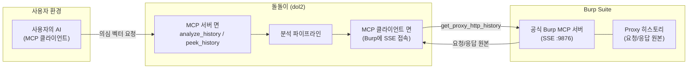

# dol2 (돌돌이)

웹 트래픽 기반 **취약점 판단 지원** MCP 서버.

돌돌이는 [PortSwigger 공식 Burp Suite MCP 서버](https://github.com/PortSwigger/mcp-server)에서 프록시 트래픽(요청/응답 원본)을 끌어와, **인증·인가 우회나 권한 상승처럼 공격이 통할 것 같은 의심 벡터**를 짚어 주는 중간 계층이다.

> ⚠️ **판정 도구가 아니라 우선순위화 도구다.** 돌돌이는 "여기 취약함"이라고 단정하지 않는다. "여기를 이런 이유로 먼저 보라"고 근거와 함께 알려줄 뿐이며, 모든 항목은 원본 패킷으로 사람이 되짚어 확인해야 한다. 반드시 **인가된 점검 대상**에만 사용한다.
>
> 🔒 **돌돌이는 능동적으로 공격 요청을 보내지 않는다.** 분석은 Burp에 이미 쌓인 트래픽 관찰에만 의존하며, PoC는 "사람이 이렇게 확인해보라"는 **제안**까지만 한다. 재전송·주입 같은 능동 행위는 사람이 직접 수행한다.

## 돌돌이의 위치 — 두 얼굴을 가진 중간 계층

한쪽으로는 Burp 공식 MCP에 **클라이언트**로 붙어 패킷을 끌어오고, 다른 쪽으로는 분석 결과를 **MCP 서버**로 노출한다.



## 판정 철학

### 1. 전체를 보지 않고 선별한다
인증·인가·권한과 **관련된 신호가 있는 요청만** 골라낸 뒤, 같은 엔드포인트를 서로 다른 신원으로 비교할 수 있게 묶는다. 인증·인가 취약점은 패킷 하나가 아니라 **"누가 / 무엇을 / 됐나 안 됐나"의 비교**에서 드러나기 때문이다.

### 2. 설정 부재는 체인이 될 때만 인정한다 (impact gate)
`Secure` 플래그나 보안 헤더가 **"빠졌다"는 사실 자체는 취약점으로 올리지 않는다.** 트래픽에서 관찰된 보강 조건과 맞물려 PoC/CVE 체인이 성립할 때만, "이게 빠져서 → 이런 공격이 가능하다"는 형태로만 보고한다.

| 전제(관찰된 부재) | + 보강 조건(트래픽에서 관찰) | → 인정되는 체인 |
|---|---|---|
| 세션 쿠키 `Secure` 없음 | 평문 HTTP 요청 존재 | 세션 쿠키 평문 노출 → 세션 탈취 (CWE-614) |
| 세션 쿠키 `SameSite` 없음 | 쿠키 인증 상태변경 POST + CSRF 토큰 없음 | CSRF (CWE-352) |
| `HttpOnly` 없음 | 반사형 XSS 표면 관찰 | 쿠키 탈취 → 계정 탈취 (CWE-1004) |
| `X-Frame-Options`/CSP 없음 | 민감 상태변경 동작 | Clickjacking (CWE-1021) |
| HSTS 없음 | 평문 HTTP 요청 존재 | SSL stripping (CWE-319) |
| CSP 없음 | 반사형 XSS 표면 관찰 | XSS 영향 확대 (CWE-693) |

**보강 조건을 못 찾으면 아예 출력하지 않는다.** (단독 hygiene 지적 = 노이즈)

### 3. 판정이 아니라 증거를 동반한 우선순위화
각 Finding은 `전제 + 보강 조건 → 공격 클래스 / CVE 힌트 / PoC 스케치 + 원본 패킷 포인터` 형태를 **강제**한다. 사람이 Burp 히스토리에서 바로 검증할 수 있다.

## 데이터 파이프라인

```mermaid
flowchart TD
    RAW["raw 히스토리<br/>(요청/응답 원본 문자열)"]
    F["① filter<br/>정적자원·텔레메트리·OPTIONS 제거<br/>+ 스코프(host) 제한"]
    N["② normalize<br/>/api/users/1023 → GET /api/users/&#123;id&#125;<br/>+ 신원 라벨링(JWT sub·쿠키·토큰)"]
    S["③ score<br/>인증·인가 신호 태깅 + 교차분석<br/>(같은 엔드포인트, 신원별 상태코드 갈림)"]
    G["④ impact gate<br/>전제 + 보강 조건 둘 다 있어야 통과<br/>단독 hygiene은 폐기"]
    OUT["Finding 목록<br/>(증거 포함, 심각도순)"]

    RAW --> F --> N --> S --> G --> OUT
```



| 단계 | 모듈 | 하는 일 |
|---|---|---|
| ① filter | `pipeline/filter.py` | 노이즈 제거 + 스코프. 애매하면 남긴다. |
| ② normalize | `pipeline/normalize.py` | 엔드포인트 템플릿화 + 신원 **추정** 라벨링 |
| ③ score | `pipeline/score.py` | 관련도 점수 + 교차분석(authz-divergent) |
| ④ gate | `gate.py` + `vectors/` | 벡터 탐지 + impact gate 강제 |

## 공식 Burp MCP가 쓰는 도구 (확인된 범위)

- `get_proxy_http_history` (count/offset 페이지네이션) — **주 입력.** 요청·응답 원본 전체 문자열
- `get_proxy_http_history_regex` — 서버단 정규식 필터
- `send_http1_request` / `send_http2_request` — 재전송(능동 검증). 스캐너 없이 "이 벡터 진짜 통하나?" 확인용
- `get_scanner_issues` — *(옵션, 나중에 스캐너 연동 시)*

접속은 **Streamable HTTP**(기본 `http://127.0.0.1:9876`, 루트 경로). 공식 서버(kotlin-sdk 0.15)는 옛 HTTP+SSE가 아니라 Streamable HTTP를 쓴다. Burp의 `MCP` 탭 Host/Port와 맞춘다.

## 알려진 한계 (솔직하게)

- **신원 라벨링은 추정이다.** Burp 히스토리는 "이건 A 사용자"라고 알려주지 않는다. 쿠키/토큰/JWT `sub`로 *추정*할 뿐이고 틀릴 수 있다. 추정 신원은 `confidence`/`source`와 함께 노출한다.
- **응답이 없을 수 있다.** Burp가 캡처 못한 항목은 `<no response>`로 온다. 돌돌이는 이 경우를 응답 신호 없이 처리한다.
- **평문 HTTP 탐지는 현재 휴리스틱**(host의 `:80`/`:8080`)이다. 실전에서는 Burp 쪽 메타데이터로 교체할 여지가 있다.
- **데이터 접근에 Burp 권한 체크**가 걸린다. 설정에 따라 "access denied"가 올 수 있으니 점검 전 승인 흐름을 켜 둔다.

## 상태

초기 골격(0.1.0). 파이프라인·게이트와 벡터들(수평 권한/IDOR, 반사형 XSS 표면, 쿠키 플래그 체인, 보안 헤더 체인)이 동작하고 스모크 테스트 11종으로 검증된다. 반사형 XSS 표면 탐지가 붙으면서 `HttpOnly`·CSP 체인의 보강조건이 채워져 두 체인이 실제로 작동한다.

**다음 단계는 기능 추가가 아니라 실측이다** — Juice Shop 같은 테스트 서버에 Burp를 걸고 돌돌이를 실제로 돌려 정탐/오탐을 확인한다. (저장형 XSS, 수직 권한 상승은 그 이후.)

## 설치 / 실행

```bash
pip install -e .          # mcp>=2,<3 설치 (FastMCP는 2.x에서 MCPServer로 개명됨)
python -m pytest -q       # 스모크 테스트
dol2                      # stdio MCP 서버로 실행 (Claude Desktop 등이 띄우는 방식)
```

Burp 접속 설정은 환경변수로:

```bash
export DOL2_BURP_BASE_URL=http://127.0.0.1:9876
# 엔드포인트가 루트가 아닐 때만 설정 (공식 서버는 보통 비워 둠)
export DOL2_BURP_HTTP_PATH=
```
